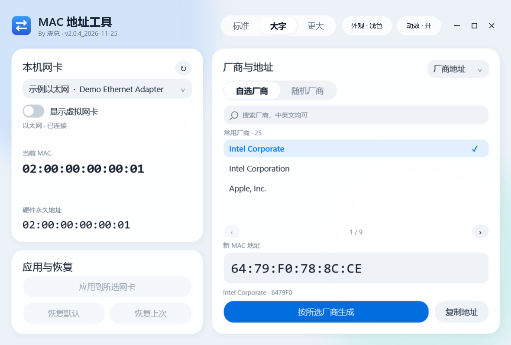

# MAC Address Tool

Windows 网卡 MAC 地址生成与管理工具。单个 EXE，离线运行，无需安装。



## 使用

在 [Releases](https://github.com/pipivv/mac-address-tool/releases) 下载 `MacAddressTool.exe`，双击运行。

如果启动时提示缺少 .NET Framework 4.8，请安装微软官方运行时，再打开 `MacAddressTool.exe`。[在线安装](https://dotnet.microsoft.com/zh-cn/download/dotnet-framework/thank-you/net48-web-installer) · [离线安装包](https://dotnet.microsoft.com/zh-cn/download/dotnet-framework/thank-you/net48-offline-installer)

1. 选择要操作的本机网卡。
2. 搜索并选择厂商，或切换到随机厂商。
3. 生成地址，可复制或应用到所选网卡。

应用和恢复时会请求管理员权限，并短暂重启所选网卡。生成、搜索和复制不需要管理员权限。

## 功能

- IEEE MA-L、MA-M、MA-S 厂商前缀；内置 54,278 条登记记录。
- 自选厂商、随机厂商、本地管理地址三种生成方式。
- 启动只显示常用厂商，搜索结果限制数量并分页，完整数据库在后台加载。
- 应用后读取实际 MAC；驱动未采用新地址时尝试恢复原设置。
- 恢复默认地址，或恢复上次操作前的配置。
- 一屏布局、三个字号按钮、明暗外观及可关闭的动态效果。

界面参照 Apple 当前 iOS 的 Liquid Glass 设计语言，在 Windows WPF 中独立实现。包含分层材质、圆角控件、悬停和按压反馈、分段选择过渡、开关及提示动画。它不使用或包含 Apple 的系统框架、字体或商标素材。

## 兼容性

支持 Windows 10 / 11 x64，需要 .NET Framework 4.8 或兼容的更高版本。并非所有网卡驱动都支持覆盖 MAC，尤其不能假定 Intel 无线驱动支持。Windows 的无线随机硬件地址设置也可能影响实际地址。

厂商模式保留 IEEE 登记前缀；本地管理地址模式不保留厂商前缀。匹配前缀不能证明硬件型号，也不保证生成地址在所在网络中绝不重复。工具不修改网卡固件。

## 隐私

程序不包含联网、遥测、账号登录或自动上传功能。本机网卡名称、GUID、当前及永久 MAC 仅在运行时读取；恢复所需的前次设置只保存在本机注册表中。

源码中的样例和仓库截图全部使用通用演示数据。公开包排除个人机器的诊断文件、日志、真实网卡截图和调试符号。发布前执行源码、说明文件和 EXE 的静态隐私检查，详见 [发布检查](docs/PRIVACY.md)。

## 从源码构建

在项目目录运行：

```powershell
powershell -NoProfile -ExecutionPolicy Bypass -File .\scripts\build.ps1
```

输出为 `dist/MacAddressTool.exe`。构建只调用 Windows 的 .NET Framework 编译器，无需下载依赖。

```powershell
.\dist\MacAddressTool.exe --core-test artifacts/core-test.json
.\dist\MacAddressTool.exe --self-test artifacts/ui-test.json
powershell -NoProfile -ExecutionPolicy Bypass -File .\scripts\privacy-check.ps1
```

## 数据与设计参考

IEEE 厂商库快照下载于 2026-10-23，来源及归属见 [第三方声明](THIRD_PARTY_NOTICES.md)。设计参考 Apple 官方 [Materials](https://developer.apple.com/design/human-interface-guidelines/materials)、[Motion](https://developer.apple.com/design/human-interface-guidelines/motion) 和 [Buttons](https://developer.apple.com/design/human-interface-guidelines/buttons)。

代码使用 MIT 许可证；IEEE 数据不适用本项目代码许可证。
